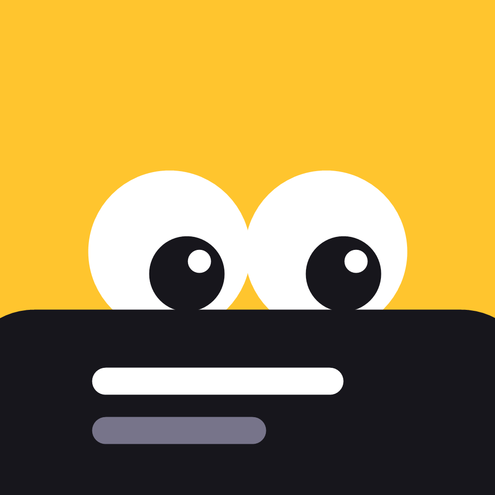
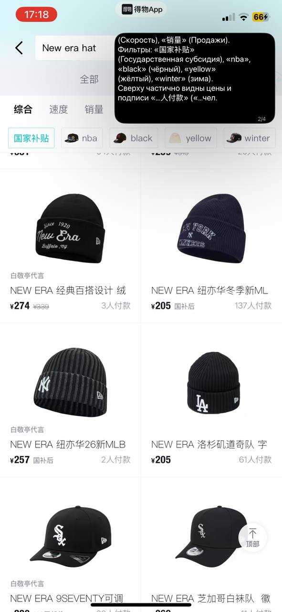

<p align="center">
  
</p>

# Oversight

A screen-aware assistant for iPhone. Ask about whatever is on your screen, and the answer floats over the app you are using. You bring your own API key, and there is no server in between.

<p align="center">
  
</p>

I started it because I was tired of taking screenshots and switching to a chat to understand what to tap. Now it is a general assistant for any screen: translate it, explain it, help you choose, tell you where to tap.

## Features

- Answers in a Picture-in-Picture window over other apps
- Pause in the window asks your first prompt preset about the current screen
- Your own questions about a screen you saved, plus editable prompt presets
- Claude, OpenAI or Gemini with your own API key
- Inexpensive models by default, any model name can be entered in Settings
- English and Russian interface

## Requirements

- iPhone with iOS 18 or later
- An API key from Anthropic, OpenAI or Google
- A computer with [Sideloadly](https://sideloadly.io) to install the app

Oversight is not on the App Store.

## Free to try

Gemini is the default provider, and [its API has a free tier](https://ai.google.dev/gemini-api/docs/pricing). On that tier Google may use what you send to improve its products and people may read it, so do not ask while private information is on the screen. Google's [terms](https://ai.google.dev/gemini-api/terms) also set age and regional conditions.

## Install

1. Download `Oversight.ipa` from the [Releases](../../releases) page.
2. Open it in Sideloadly, connect your iPhone, sign in with your Apple ID and start.
3. On the iPhone, turn on Developer Mode (Settings, Privacy & Security) and trust your profile (Settings, General, VPN & Device Management).

With a free Apple ID the signature lasts 7 days. Install the app again after that.

## Use

1. Open Settings in the app and add your API key.
2. Tap the red button and start the screen broadcast.
3. Open the floating window.
4. Switch to the other app.
   - Pause in the floating window runs your first preset.
   - Skip back saves the current screen without sending it.
   - On a long answer the skip buttons turn pages instead.
5. To ask something specific, save the screen, switch to Oversight and type your question. The window's full-screen button saves the screen and opens Oversight in one step.

## Limits

- iOS does not let apps draw over other apps, so Oversight cannot highlight buttons. It describes where to tap.
- The screen broadcast has to be running, and iOS shows its recording indicator.
- Apps that block screen capture give a black picture.
- The floating window covers part of the screen, and what is under it is not seen.

## How it works

See [docs/architecture.md](docs/architecture.md). What leaves your phone is described in [PRIVACY.md](PRIVACY.md).

## Build

The project is generated with [XcodeGen](https://github.com/yonaskolb/XcodeGen):

```sh
xcodegen
swift test --package-path Packages/OversightCore
```

GitHub Actions runs the tests and builds an unsigned `.ipa` on every push.

## License

MIT, see [LICENSE](LICENSE).
