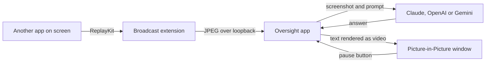

# Architecture

## Parts

- `OversightBroadcast`: a broadcast upload extension. It scales a frame to at most 1280 px, encodes it as JPEG and passes it on, about twice a second. It does no networking beyond the phone.
- `App`: settings, the recent screens, requests to the provider and the floating window.
- `Packages/OversightCore`: providers, frame transfer, text paging, prompts, settings and key storage.

## Choices forced by iOS

**No overlays.** An app cannot draw over another app. A Picture-in-Picture window can stay on top, so the answer is drawn into video frames for an `AVSampleBufferDisplayLayer`. The pixel buffers must be IOSurface-backed, otherwise the window is black.

**No App Group.** A profile signed with a free Apple ID did not grant the App Group, so the extension sends frames over loopback. The app signs a random value with its own key, and the extension only sends to a receiver that holds the key it saw first.

**Recent screens.** A screen is offered for questions only after it stays still for 1.5 seconds, so app switching and scrolling are left out.

**Staying alive.** The app keeps receiving in the background while the floating window is open.

**Memory.** Broadcast extensions have a small memory limit, so only one frame is processed at a time.
